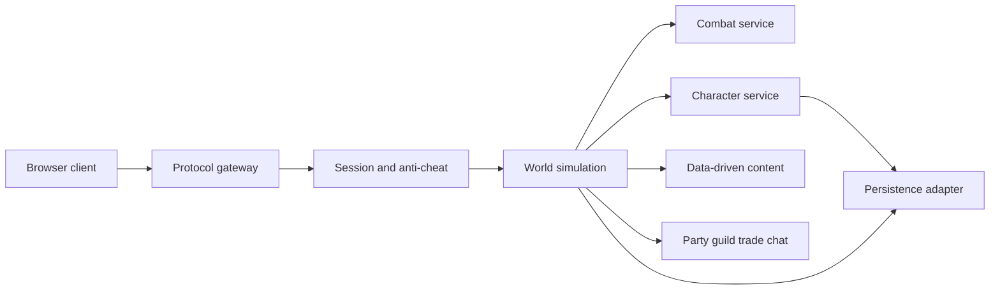

# Kaiser Quest architecture

## Current implementation audit

The project is the original BrowserQuest architecture: an AMD browser client, a CommonJS Node server, and shared numeric game types. `server/js/main.js` creates five independent `WorldServer` instances. Each world loads `server/maps/world_server.json`, simulates mobs at 50 updates per second, and sends only entities relevant to the player's adjacent map groups.

`server/js/ws.js` now hosts the client directory, `/status`, and a modern RFC 6455 WebSocket endpoint on the same port. It preserves the JSON array protocol. A connecting player receives `go`, sends `HELLO`, then receives `WELCOME`; client messages and relevant entity updates drive synchronization. The obsolete Hixie WebSocket and BISON branches have been removed because current browsers do not support them.

The canvas renderer loads tile sheets from `client/img/{1,2,3}`, sprites from PNG plus `client/sprites/*.json`, and the client map from `client/maps/world_client.json`. The map worker builds collision and plateau grids. Rendering draws low tiles, entities, effects, then high tiles. Existing sprite metadata is row based and uses a fixed frame width and height per sprite.

Collision is tile based. The server checks bounds and collision cells in `Map`/`WorldServer`; the client uses the corresponding grid and A* pathfinding for movement display. Current movement accepts valid destinations but has no rate, adjacency, or path validation, so this requires server-side hardening before competitive gameplay.

Combat is partially server calculated: weapon and armor levels feed `Formulas.dmg`, mobs track hate, and WorldServer resolves death, drops, despawn, respawn, and health messages. The client still chooses when to send `HIT` and `HURT`; range, cooldown, attack timing, and whether a mob struck a player are not authoritatively simulated. This is the first gameplay system to replace.

Items are world entities. Equipment pickups immediately replace the active weapon or armor; healing and fire potion effects are special cases. There is no inventory, stack system, persistence, character selection, account, experience, level, class, skill, quest, crafting, party, guild, or trade system. Browser local storage preserves a name, appearance selections, and achievement counters only; it is not trusted server save data.

Maps are exported from TMX through `tools/maps` into separate client/server JSON. Doors, checkpoints, collision cells, mob areas, chest areas, static entities, and zone groups are encoded in those exports. The existing single map can be reused as the first region; multiple regions need a world/instance registry and explicit portal transitions.

## Modernization completed in Task 001

- Pinned runtime dependencies and removed unavailable `sanitizer`, `websocket`, `websocket-server`, `bison`, and unused-by-default `memcache` from installation.
- Replaced the obsolete WebSocket adapter with `ws` while keeping its public connection methods and JSON protocol.
- Added static client delivery from the game server for local development.
- Replaced the legacy sanitizer package with small server-side HTML escaping for current text rendering paths.
- Corrected a `main.js` declaration error that leaked `worlds` as a global.

Metrics still requires the legacy `memcache` module when `metrics_enabled` is true. It is disabled by default and should be redesigned behind a metrics adapter before enabling it.

## Task 002: authoritative combat core

`server/js/combat.js` is the single source for combat range and cooldown rules. WorldServer now advances combat on its server tick: mobs with an in-range target calculate and apply their own damage. Player HIT packets request an attack, but the server accepts it only when the player has selected that mob, both entities are alive, they are adjacent, and the server cooldown has elapsed. Client HURT packets no longer change server health.

Movement advances one valid tile at a time. Loot movement, item pickup, and chest opening must be within interaction range. These checks form an incremental compatibility layer around the original protocol; teleport validation, server path execution, abilities, status effects, and persistence remain later phases.

## Target modular design

Introduce modules incrementally: a protocol validator and per-tick input queue; authoritative combat state with abilities, cooldowns, effects, threat, and boss scripts; character aggregates for class, stats, equipment, inventory, XP, skills, and quests; region/instance services; and a persistence adapter with migrations. Keep content definitions separate from simulation code. Every state-changing request needs identity, ownership, range, cooldown, and state validation.
